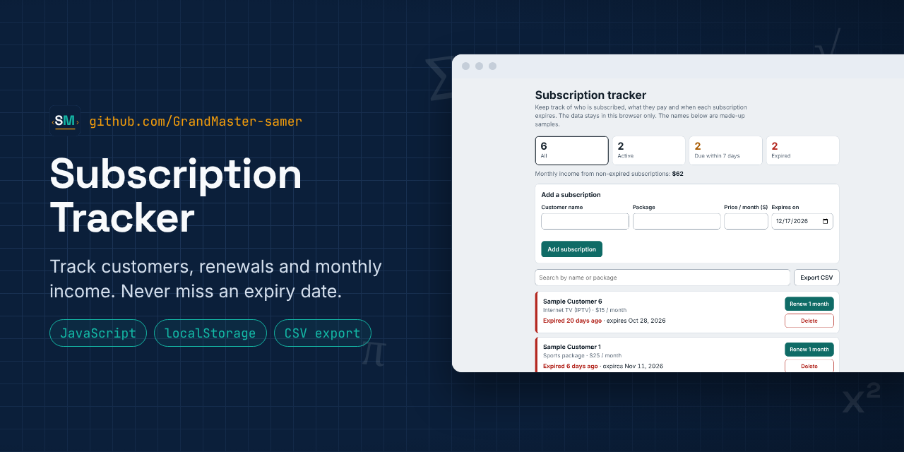
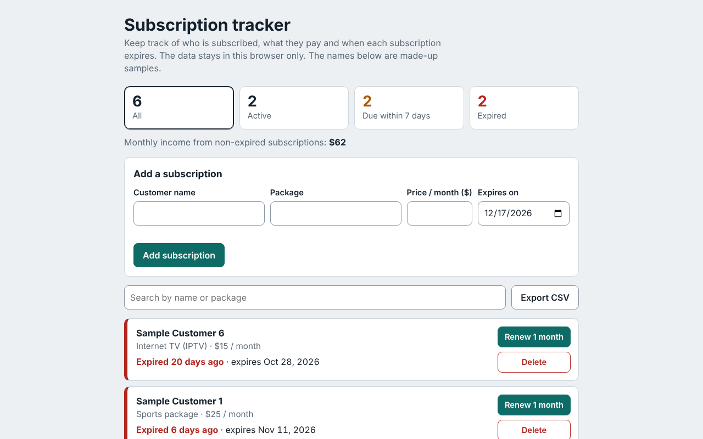

# Subscription Tracker

A simple web page for tracking customer subscriptions: who is subscribed, which package, how much they pay, and when it expires. It highlights subscriptions that are due soon or already expired, so renewals are not forgotten. It is a single `index.html` file with no libraries and no server.

**[▶ Try the live demo](https://grandmaster-samer.github.io/subscription-tracker/)**

## Screenshots

<!-- Optional: add docs/screenshot-mobile.png to show the phone layout -->

## Features

- Add subscriptions with customer name, package, monthly price and expiry date
- Automatic status for each subscription: active, due within 7 days, or expired
- One-click **Renew 1 month** (renews from today if already expired, otherwise from the current expiry date)
- Filter by status, and search by name or package
- Monthly income total for subscriptions that have not expired
- Export everything to a CSV file that opens in Excel or Google Sheets
- Data is saved in your browser (`localStorage`), so it stays after you close the page

## How to use

1. Open `index.html` in a browser, or visit the live page (see below).
2. Fill in the form and press **Add subscription**.
3. Use the boxes at the top to filter, and the buttons on each row to renew or delete.

## Notes

- Data is stored only in the browser you use. Clearing the browser data, or opening the page on another device, starts again with the sample data.
- Dates are handled in local time. Renewing on the 31st moves to the last day of shorter months.

## Live demo and GitHub Pages

**Live demo:** https://grandmaster-samer.github.io/subscription-tracker/

To publish it yourself:

1. Open the repository on GitHub and go to **Settings → Pages**.
2. Under **Build and deployment**, set **Source** to **Deploy from a branch**.
3. Choose the `main` branch and the `/ (root)` folder, then click **Save**.
4. After about a minute the site is live at `https://grandmaster-samer.github.io/subscription-tracker/`.
5. Copy that address into the repository's **About → Website** field so it shows at the top of the repo.

## What I learned

- Modelling state (active, due soon, expired) from dates, and date maths that handles month ends.
- Persisting data with `localStorage` and exporting CSV that opens cleanly in Excel.
- Building a small business tool from a real need (renewal tracking for a subscription service).

## License

MIT. See [`LICENSE`](LICENSE).

---

Built by [Samer Monzer](https://github.com/GrandMaster-samer) · [LinkedIn](https://www.linkedin.com/in/samer-monzer-51266727a)
